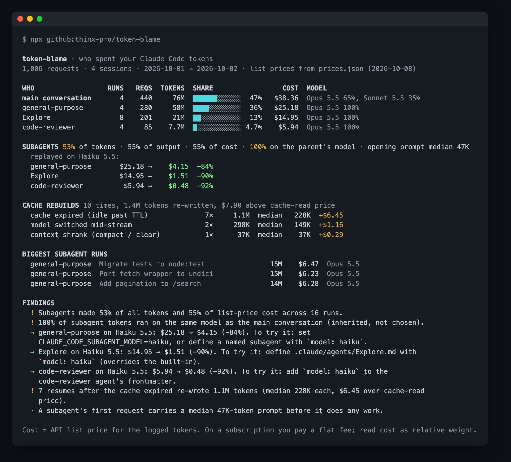

# token-blame

**`git blame` for your Claude Code tokens.** See how much went to the main conversation and how much to each subagent type, which subagents just inherited your expensive model, and how many tokens went into cache rebuilds (and why). Then see what those subagents would have cost on Haiku 5.5.

<!-- agent-preflight -->
> **Also a Claude Code skill.** `token-blame` is part of [agent-preflight](https://github.com/thinx-pro/agent-preflight), 16 offline checks for coding agents: `/plugin marketplace add thinx-pro/agent-preflight` then `/plugin install token-blame@agent-preflight`, and ask Claude in plain words.

   



<sub>Screenshot: the bundled synthetic demo (`npm run demo`), not real usage.</sub>

## Why

Usage tools tell you *how many* tokens you used. They don't say *who* used them.

- A [month of Claude Code logs broken down on dev.to](https://dev.to/aidiveyt/the-september-cut-took-17-of-my-claude-code-week-subagents-were-taking-48-98n) (455 sessions) found subagents took **48% of tokens** and 64% of output. Subagents ran on whatever model the main session used, and the smallest model handled under 1% of subagent requests. The popular tips (drop a few MCP servers, filter shell output) saved almost nothing by comparison.
- Per the [Claude Code subagent docs](https://code.claude.com/docs/en/sub-agents), a subagent with no `model` set falls through to the main conversation's model. The built-in `Explore` does the same unless you override it.
- Resuming a session after the prompt cache has expired writes the whole context into cache again. That cost doesn't show up as a line item anywhere.

token-blame answers "who spent it" from your own logs, in one command.

## Quick start

```bash
npx github:thinx-pro/token-blame
```

That's it. It reads `~/.claude/projects` (or `$CLAUDE_CONFIG_DIR/projects`), prints a report, and sends nothing anywhere.

```bash
npx github:thinx-pro/token-blame --since 7d --project my-app   # one week, one project
npx github:thinx-pro/token-blame --to sonnet-5.5                # replay subagents on Sonnet instead
npx github:thinx-pro/token-blame --md > usage.md                # shareable summary (no task text)
```

## What it shows

| Section | What it tells you |
|---|---|
| **WHO** | Tokens, share and list-price cost split into the main conversation and each subagent type (`Explore`, `general-purpose`, `fork`, your custom agents), with the model mix for each |
| **SUBAGENTS** | Subagent share of tokens, output and cost. How much ran on the same model as the parent at spawn time. Median size of a subagent's first prompt (its "startup tax"). Replay on a cheaper model, per type |
| **CACHE REBUILDS** | Requests that re-wrote ≥10K tokens to cache instead of reading them, grouped by cause: *expired* (idle past the 5 min / 1 h TTL), *model switched*, *context shrank* (compact / clear), *rebuilt before TTL* (prefix changed: tools, MCP servers, memory) |
| **BIGGEST SUBAGENT RUNS** | The most expensive individual runs, with their task description (hide with `--no-desc`) |
| **FINDINGS** | Plain-language takeaways, each with the config change that acts on it |

The suggested fixes follow the documented resolution order:

```markdown
<!-- .claude/agents/Explore.md: overrides the built-in Explore -->
---
name: Explore
description: Fast read-only codebase search
tools: Read, Grep, Glob
model: haiku
---
```

or for every subagent at once, in `settings.json`:

```json
{ "env": { "CLAUDE_CODE_SUBAGENT_MODEL": "haiku", "CLAUDE_CODE_SUBAGENT_MODEL_FORCE": "1" } }
```

## How it works

1. Walks every `*.jsonl` under the projects folder. Subagent transcripts live in `<session>/subagents/agent-<id>.jsonl`, and the type comes from the `agent-<id>.meta.json` next to each one (falling back to `attributionAgent` / `isSidechain` in older logs).
2. Claude Code writes one line per content block, and each line repeats the same `usage`. token-blame keeps one request per API message id, and also dedupes messages copied between files by resumed sessions.
3. Tokens = uncached input + cache writes (5 m / 1 h) + cache reads + output. That matches what the dev.to breakdown counted.
4. Cost uses the API list prices in [`prices.json`](prices.json) (retrieved 2026-10-08 from the official pricing pages), including Haiku 5.5's higher rate above 100K prompt tokens.
5. The replay re-prices each subagent request on the target model. The first request of each run is billed as a full cache write, because a subagent on a different model can't read the prompt cache it shared with its parent.
6. Rebuild detection looks at consecutive requests within one stream (the main session, or one subagent run). The TTL comes from the previous request's cache-write type.

## Limitations

- **List price, not your bill.** On Pro / Max you pay a flat fee. Read the dollar figures as relative weight, or as what the same work would cost on the API.
- **The replay assumes the same tokens.** A cheaper model may need more turns, or do worse work. token-blame shows you where it's worth trying, not that it will work.
- Skills and MCP tool definitions are part of every prompt, so they can't be separated out of usage numbers. They show up in the "opening prompt" median.
- Claude Code only for now; Codex logs aren't parsed yet.

Roadmap: per-day trend, Codex / OpenCode logs, an `--html` report, and a statusline mode that shows the subagent share live.

## Development

```bash
npm test                 # node:test, no dependencies
npm run demo             # generate the synthetic demo logs and run on them
```

## License

MIT

If this told you something about your own usage you didn't know, a ⭐ helps other people find it.

---

### 中文说明

**token-blame**：给 Claude Code 的 token 做「归因」。它把用量拆成主会话和各类子 Agent（Explore、general-purpose、fork、自定义 Agent），标出有多少子 Agent 只是继承了主会话的贵模型，统计缓存重写的次数和原因（空闲超过 TTL、切换模型、压缩、前缀变化），并估算把子 Agent 换成 Haiku 5.5 后能省多少。运行 `npx github:thinx-pro/token-blame` 即可，零依赖，只读本地日志，不联网。金额按 API 标价计算，订阅用户可以把它当作相对权重来看。换模型的估算假设 token 数不变，质量是否够用需要自己验证。
